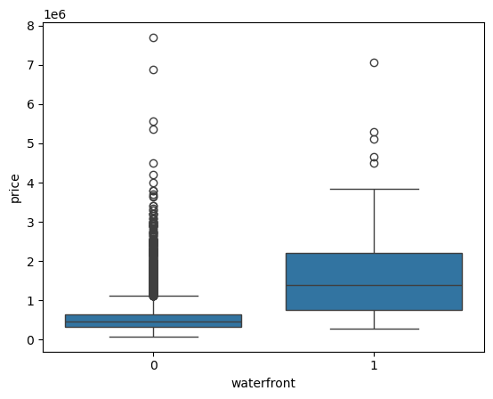
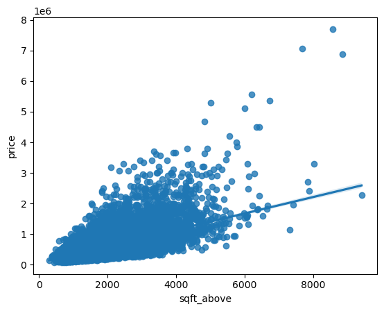

# Data Science Projects — Xie Yihan

Three course-derived projects prepared for CISC7204 Practice 09. These are learning projects, with their course origin explicitly credited.

## 1. King County House Prices
Research question: How do above-ground area and waterfront status relate to house sale prices?
The existing course notebook covers cleaning, exploratory plots and regression. This package adds a compact standard-library script reproducing descriptive findings.

Source: [House Sales in King County](https://www.kaggle.com/datasets/harlfoxem/housesalesprediction); the course-modified CSV is obtained from IBM Skills Network (URL in analysis.py). The original dataset is described as CC0 by the moderndive dataset documentation; permission for redistribution of the modified course CSV remains unverified, so no raw data is uploaded.

Findings reproduced against the local course CSV: 21,613 rows; above-ground area and price Pearson correlation 0.605567; median prices $450,000 without waterfront and $1,400,000 with waterfront. Waterfront groups contain 21,450 and 163 records respectively.

Limitation: observational, historical 2014–2015 sales, unequal groups and omitted property characteristics; neither comparison establishes causality or current market values.

Run with Python 3.8+: `python analysis.py` (downloads the course CSV), or `python analysis.py --data /path/to/housing.csv`. Outputs results.json. No third-party dependencies are needed. The descriptive script was run successfully using the original local CSV. Existing notebook chart outputs are in .

## 2. Laptop Pricing
See [code, charts, methods and limitations](laptop-pricing_README.md).

## 3. Automobile Sales Dashboard
See [dashboard code, screenshots and run instructions](automobile-dashboard_README.md).

## Attribution and AI assistance
Source coursework: CISC7204; housing and laptop exercises use IBM Skills Network data/resources. Public materials retain project provenance; original copyrighted lesson templates, assessment files, teammate materials and raw course datasets are excluded. AI assisted packaging, documentation and the new housing descriptive script. Xie Yihan should review all materials before publication.

## Verification status
Housing descriptive script executed successfully. All included Python files passed syntax checks. Laptop and dashboard reruns passed; see [reproduction report](reproduction-report.md). Public repositories and the portfolio website are accessible. Classmate review was confirmed by Xie Yihan; the portfolio now includes a comparison table added in response. See the [review record](https://github.com/LiviaFragmo/data-science-portfolio/blob/main/review-and-improvement.md).
